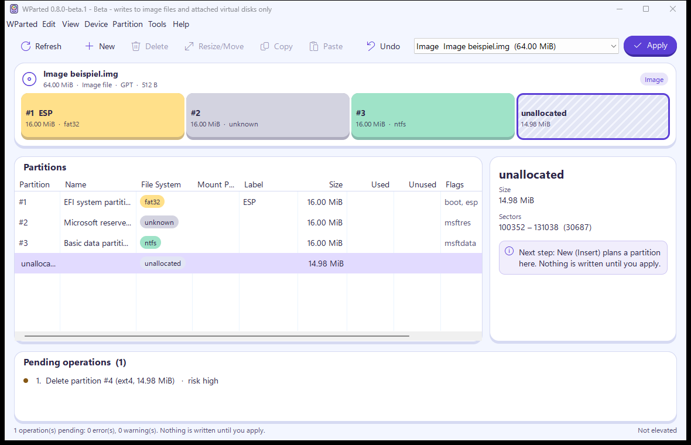

<!-- SPDX-License-Identifier: GPL-2.0-or-later -->

# WParted: free, open-source partition manager for Windows 11

**WParted is a free, open-source partition manager for Windows 11 with a GParted-style workflow.** It shows disks,
partition tables and file systems, plans changes without touching anything, and then applies them to disk image files
and attached virtual disks (VHD/VHDX). It runs natively on Windows, without a Linux live system or an installer.

> **Status: beta (0.8.0-beta.1).** Writing to real disks is locked until a human security review is done, and the
> disk of the running Windows is never written. Real disks can be inspected and plans can be made for them.
> Details: [project status](docs/PROJECT-STATUS.md).

## Quick facts

| | |
|---|---|
| **What it is** | Native Windows partition manager and GParted-style alternative for Windows |
| **Platform** | Windows 11; x64, x86 build for 64-bit Windows, ARM64 built but not yet run |
| **Licence** | GNU GPL v2.0 or later, free of charge |
| **Partition tables** | GPT and MBR, including extended and logical partitions |
| **File systems changed** | NTFS, FAT16/32, exFAT, ext2/3/4; btrfs can grow; XFS, btrfs and swap labels and UUIDs |
| **File systems detected** | 31 types, including ReFS, BitLocker, F2FS, LUKS, LVM, HFS+, APFS and ZFS |
| **Interfaces** | Desktop app (English and German, light and dark) and command line (`wparted-cli`) |
| **Privacy** | No telemetry, no automatic update checks, no network use |
| **Website** | [wparted.tracht-digital.de](https://wparted.tracht-digital.de/) |

## What can WParted do?

| Area | What works today |
|---|---|
| Inspect disks | Model, serial, bus (NVMe, SATA, USB, SD), size, sector sizes, SSD, write protection, drive letters, used and free space, BitLocker state |
| Plan changes | Create, delete, resize, move, copy, format, label, name, set flags, new partition table; future layout, undo, safety checks, saved plans |
| Apply changes | On raw images, fixed-size VHD files and attached VHD/VHDX disks, each step read back and verified |
| Resize file systems | NTFS, exFAT, FAT16/32 and ext2/3/4 grow and shrink, and shrinking moves the data behind the new end; btrfs grows |
| Create and check | NTFS, FAT16/32, exFAT and ext2/3/4; read-only checks for NTFS, FAT and ext |
| Recover | Search free space for lost partitions and plan recreating them; resume an interrupted move |
| Drive letters | Mount and unmount volumes, except those of the running Windows |
| Automate | `wparted-cli` with JSON output and dry runs |
| Accessibility | Keyboard operation, screen-reader names, high-contrast colours (not yet checked by hand) |

Full status per file system and action: [capability matrix](docs/research/gparted-parity-matrix.md).

## How does WParted compare?

| | WParted | Windows Disk Management | GParted |
|---|---|---|---|
| Runs inside Windows | Yes | Yes | No, needs Linux or a live system |
| Plan first, apply later | Yes | No | Yes |
| Move a partition's start | Images and virtual disks | No | Yes |
| Handles ext2/3/4 | Images and virtual disks | No | Yes |
| Writes to real disks | **Not yet (locked)** | Yes | Yes |
| Maturity | Beta | Part of Windows | Mature, long established |

For work on real disks today, use the mature tools. WParted is an independent project, not affiliated with or
endorsed by the GParted or GNOME projects.

## How do I install WParted?

1. Download the portable ZIP from [GitHub releases](https://github.com/jtracht/WParted/releases). No installer is needed.
2. Extract it and start `wparted.exe`.
3. To read the partition tables of real disks, choose **WParted → Restart as Administrator**.

The newest published build can be older than this page. Binaries are not code-signed yet, so Windows may show a
warning. To build from source, see [building](docs/developer/building.md).

## Frequently asked questions

**Is WParted a GParted alternative for Windows?** Yes, in its workflow: it follows GParted's disk map, operation queue
and apply step, and runs natively on Windows. It does not yet reach GParted's scope, because writing to real disks is locked.

**Is WParted safe to use on my disks?** Yes for reading: in this version it does not write to real disks. Plans for
them can only be checked and saved. Back up your data before relying on any partition tool.

**Does WParted work on Windows 10?** It is not supported or tested. Windows 11 is the only target.

More answers: [FAQ](docs/FAQ.md) · [FAQ auf Deutsch](docs/FAQ.de.md)

## Documentation

- **Users:** [user guide](docs/user/en/user-guide.md) · [Benutzerhandbuch](docs/user/de/benutzerhandbuch.md) · [FAQ](docs/FAQ.md) · [changelog](CHANGELOG.md)
- **Status:** [project status](docs/PROJECT-STATUS.md) · [Windows support matrix](docs/compatibility/windows-support-matrix.md) · [roadmap](ROADMAP.md)
- **Architecture:** [technology decision](docs/architecture/technology-decision.md) · [security](docs/architecture/security-architecture.md) · [validation rules](docs/architecture/validation-rules.md) · [failure modes](docs/architecture/failure-modes.md)
- **Research:** [GParted architecture](docs/research/gparted-architecture.md) · [feature inventory](docs/research/gparted-feature-inventory.md) · [UI analysis](docs/research/gparted-ui-analysis.md) · [Windows portability](docs/research/windows-portability-analysis.md)
- **Contributors:** [contributing](CONTRIBUTING.md) · [building](docs/developer/building.md) · [testing](docs/developer/testing.md) · [release process](docs/developer/release-process.md) · [CI setup](docs/developer/infrastructure-setup.md) · [design system](docs/design/wparted-design-system.md)

## Kurzfassung auf Deutsch

**WParted ist ein freier Open-Source-Partitionsmanager für Windows 11 mit GParted-ähnlicher Bedienung.** Er zeigt
Datenträger, Partitionstabellen und Dateisysteme, plant Änderungen und führt sie auf Image-Dateien und angehängten
virtuellen Datenträgern (VHD/VHDX) aus. **Echte Datenträger bleiben bis zum Sicherheitsreview gesperrt.**
Mehr dazu im [Benutzerhandbuch](docs/user/de/benutzerhandbuch.md) und in den [häufigen Fragen](docs/FAQ.de.md).
Fehler und Wünsche bitte über [GitHub Issues](https://github.com/jtracht/WParted/issues) melden.

## Support and security

Report bugs through [GitHub Issues](https://github.com/jtracht/WParted/issues), and attach the exported report if
possible. Report security problems privately: see [SECURITY.md](SECURITY.md).

## License

WParted is licensed under the **GNU General Public License v2.0 or later** ([LICENSE](LICENSE)).
Third-party notices: [THIRD_PARTY_NOTICES.md](THIRD_PARTY_NOTICES.md).
