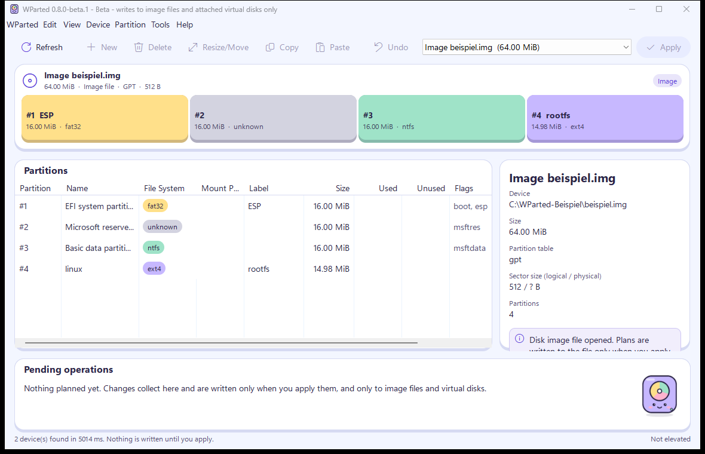
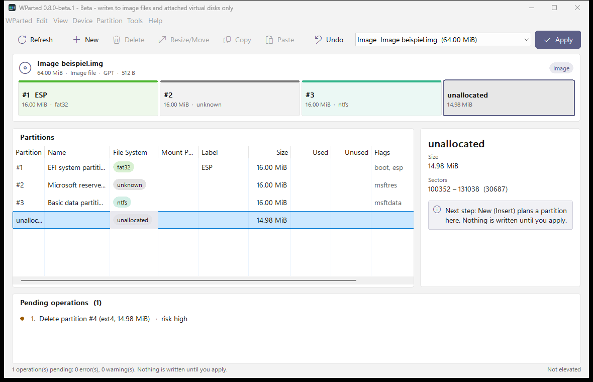
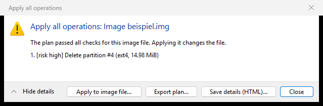
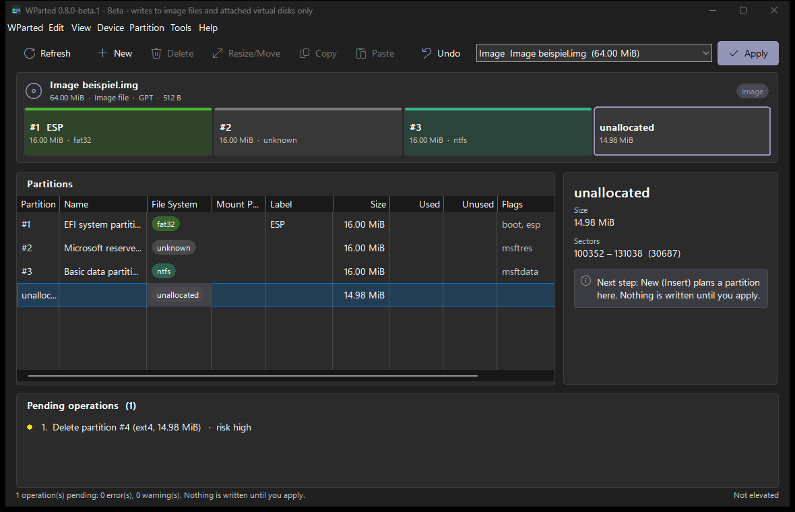

<!-- SPDX-License-Identifier: GPL-2.0-or-later -->
# WParted user guide: partition manager for Windows 11 (v0.8.0-beta.1)

**This guide explains how to install WParted, inspect disks, plan partition changes and apply them.** WParted applies
changes to image files and attached virtual disks; real disks can be inspected and planned for, but stay locked.
Short answers: [FAQ](../../FAQ.md).

## Screenshots



*Main window with an example disk image: disk map on top, partitions below.*



*A planned deletion. The map shows the future layout; nothing has been written.*



*Apply summary: every step with its risk and the result of the checks. Writing is never the default button.*



*Dark theme.*

## What is WParted?

WParted is a free, open-source partition manager for Windows with a GParted-style workflow. It shows
your disks, partition tables, file systems and volumes, plans changes for every disk, and **executes
plans on disk image files and attached virtual disks (VHD/VHDX)**. **Real disks stay locked for now**, and
the disk of the running Windows is never written.

## Installation and first start

1. Download `WParted-v<version>-win11-x64-portable.zip` (or `-x86` for 32-bit Windows) from the
   GitHub releases page and verify the SHA-256 checksum from `…-checksums.sha256`.
2. Extract the ZIP to any folder. No installation or runtime is required.
3. Run `wparted.exe`.

Without administrator rights WParted shows only the volumes Windows has mounted, and the regions
between them as **unknown (hatched)**. To read the real partition tables, click
**Restart as Administrator** in the yellow banner (or *WParted → Restart as Administrator*).

## The main window

| Area | Purpose |
|---|---|
| Toolbar | Refresh, and the partition actions known from GParted. Actions that are not available yet are greyed out; hover for an explanation. |
| Device selector | Choose the disk to display. `[Windows]` marks the disk containing the running Windows. |
| Disk map | Each box is a partition, sized proportionally. Colour = file system, solid = used space, lighter = free space in the file system. Striped = unallocated, hatched = unknown. Use ←/→ to move, Enter for details. |
| Partition list | Partition, name, file system, mount point, label, size, used, unused, flags and status. Double-click or Enter shows details; right-click opens the partition menu. |
| Details pane | Properties of the selected partition or free space, and why an action is not available. |
| Pending operations | The planned changes in order, with risk and validation status. |
| Status line | Scan result, warnings found in the partition table, and whether WParted runs with administrator rights. |

## Planning operations

WParted **plans** changes the GParted way. On physical disks nothing is written: *Apply* only shows the
checks. On **disk image files** plans can be applied (see below).

1. Select a partition or unallocated space in the disk map or the list.
2. Choose an action: *New*, *Delete*, *Resize/Move*, *Copy*/*Paste*, *Format to*, *Name Partition*,
   *Label File System*, *New UUID*, *Manage Flags*, *Check*, or *Device → Create Partition Table*.
   Dialogs show a preview of the resulting layout; sizes are entered in MiB, alignment is 1 MiB by
   default (*Align to: None* skips rounding up to a MiB boundary).
3. The disk map shows the **future layout**; *Pending operations* lists every step. *Undo* (Ctrl+Z)
   removes the last one, *Edit → Clear All Operations* removes all.
4. *Apply* (Ctrl+Enter) validates the plan and shows a summary with risks and blocking errors
   (for example system partitions, busy or encrypted volumes, partitions smaller than their data,
   overlaps, MBR limits). From there you can **export the plan** (JSON) or **save details (HTML)**.
5. *Edit → Save Plan* (Ctrl+S) stores the plan. It records the disk identity (serial, size, table
   GUID/signature), so a plan cannot silently be applied to a different disk.

To try this without touching a real disk, use *WParted → Open Disk Image* (Ctrl+O) with a raw image
file (`.img`).

## Applying a plan to a disk image file

Image files are raw disk images (`.img`, `.raw`, `.bin`, …) or **fixed-size VHD** files (as created by
Hyper-V or Disk Management with "fixed size"); WParted keeps the VHD footer intact. Dynamic VHD and
VHDX files are not supported yet and are refused with an explanation.

For an opened image file, *Apply* validates the plan for the image and, if it passes, offers
**Apply to image file…**. A second confirmation names the file; there is no automatic undo, so copy
the file first if you may need its current state. WParted then

- writes each operation and **reads the partition table back** before the next one (the first
  mismatch stops the plan),
- moves and copies partitions as raw blocks (any file system, same size),
- clears old file system signatures at the start of new partitions,
- shows every step in the result and re-reads the image.

Possible on images:

| | create | grow | shrink | move / copy | check | label | new UUID |
|---|---|---|---|---|---|---|---|
| FAT16 / FAT32 | ✓ | ✓ | ✓ (data is relocated) | ✓ | ✓ read-only | ✓ | ✓ |
| NTFS | ✓ simplified system files¹ | ✓ | ✓ if the space behind the new end is free | ✓ | ✓ read-only | ✓ | ✓ |
| exFAT | ✓ | ✓ while the FAT has room² | ✓ if the space behind the new end is free | ✓ | – | ✓ | ✓ |
| ext2 / ext3 / ext4 | ✓ without metadata checksums | ✓ within the descriptor blocks | ✓ if the space behind the new end is free | ✓ | ✓ read-only | ✓ | ✓ |
| Linux swap | – | – | – | ✓ | – | ✓ | ✓ |
| any other | – | – | – | move ✓, copy where safe | – | – | – |

Also: new partition tables, new or deleted partitions, flags and names. Moves and copies are raw block
operations of the same size; a copy into a larger FAT partition grows the copied file system. Plans
with steps WParted cannot do are refused before anything is written, as are shrinks of NTFS volumes
that do not fit and file systems with errors. Shrinking moves data from behind the new end. A heavily fragmented `$MFT` or ext extent tree stops the
shrink before anything changes. btrfs and XFS can grow, not shrink; XFS needs a clean log, so unmount it properly on Linux first. Repairs are left to the file
system's own tools (`chkdsk`, `e2fsck`).
Real disks stay locked in this build.

**Virtual disks.** Attach a VHD/VHDX in Windows, restart WParted as administrator so it can read the table,
and plan as usual. *Apply* asks for administrator rights (UAC), locks and dismounts all volumes of that
disk, and works like on an image file. **Mount** and **Unmount** in the *Partition* menu act at once.

¹ Verified with ntfs-3g; Windows' chkdsk has not checked it yet and may complete `$Secure`, `$Extend`
and the up-case table. ² exFAT volumes WParted creates leave room to grow.

Extended partitions can be moved too (their boundaries; the logical partitions
stay where they are).

### Interrupted executions

WParted keeps a journal next to the image (`<image>.wparted-journal`) while it applies a plan. If the
program, the computer or the power fails, or you cancel during a move, the journal shows where it
stopped:

- **between operations** or **during a block move or copy**: WParted can continue exactly there.
  The GUI offers *Resume* when you open the image again; on the command line run
  `wparted-cli resume <image>` to see the state and `--execute` to continue. Until then, the data of
  an interrupted move is split between the old and the new position – do not use the image.
- **during a step that changes data in place** (file-system resize or creation, writing the table):
  this cannot be resumed; WParted says so and the image may be inconsistent. Restore it from your copy.

*Discard the journal* (or `--discard`) deletes only the journal, never the image. Details:
[failure modes](../../architecture/failure-modes.md).

## Data rescue

*Device → Attempt Data Rescue* searches the unallocated space of the selected disk or image for file
systems that no partition covers any more (for example after a partition was deleted). It checks
1 MiB steps and old cylinder boundaries, runs in the background and only reads.

The result lists start sector, file system, size and label, and whether the start is MiB-aligned.
**Add to the plan** recreates the partitions exactly around the found file systems (also at non-MiB
starts). Nothing inside them is written; after the table is written each file system is detected and
checked again. Review the plan, keep a copy, then apply it (image files) – the command line does the
same with `wparted-cli rescue-scan-image <image> --plan rescue.json` and `apply-plan`. Scanning a
physical disk needs administrator rights (`wparted-cli rescue-scan <disk>`); recreating partitions is
only executed on image files.

## Useful functions

- **View → Device Information**: model, serial, interface, sector sizes, SSD, write protection, table
  type, GPT header health and all diagnostics.
- **Partition → Information**: sector range, alignment (1 MiB and physical sector), GUIDs, attributes,
  flags, mount points and usage.
- **View → File System Support**: what this build can do for each file system.
- **Device → Export Report**: saves a JSON report of all disks (useful for bug reports).
- **View → Theme**: System, Light or Dark.
- **Tools → Open Log Folder**: `%LOCALAPPDATA%\WParted\logs`.

## Command line

```text
wparted-cli list [--json]                       list disks, partitions, volumes
wparted-cli inspect-image disk.img [--sector-size 4096] [--json]
wparted-cli fs-support [--json]
wparted-cli rescue-scan-image disk.img [--sector-size 4096] [--json]
wparted-cli apply-plan disk.img plan.json [--execute] [--log details.html]   check, or apply to the image
wparted-cli apply-plan disk.img plan.json --execute --helper  the same through wparted-helper.exe
wparted-cli apply-plan \\.\PhysicalDriveN plan.json --execute --yes-write-to-disk   attached virtual disk (UAC)
wparted-cli resume \\.\PhysicalDriveN --execute --yes-write-to-disk                 continue on a virtual disk
wparted-cli mount \\?\Volume{...}\ E:\                       assign a drive letter (UAC)
wparted-cli unmount E:\                                       remove the mount points of that volume (UAC)
wparted-cli resume disk.img [--execute [--helper] | --discard]  show or continue an interrupted execution
wparted-cli rescue-scan-image disk.img --plan rescue.json      plan recreating the partitions found
wparted-cli rescue-scan 0                                      read-only rescue scan of disk 0 (administrator)
wparted-cli version
```

Run from an administrator prompt to include partition tables. Exit code of `inspect-image` is 1 if the
table has errors.

## Frequently asked questions

**Is WParted free?** Yes, GPL-2.0-or-later.
**Can WParted resize or delete partitions?** On image files and attached virtual disks, yes. On real disks it plans and
validates, but does not execute: that needs a human security review first.
**Which Windows does WParted support?** Windows 11. Windows 7–10 are no longer supported.
**Can WParted read Linux partitions?** It detects ext2/3/4, btrfs, XFS, swap, LUKS, LVM and more, and
shows their labels. On image files and virtual disks it can change ext2/3/4, grow btrfs and XFS and change the labels and UUIDs of XFS, btrfs and swap.
**Is it related to GParted?** No. WParted follows GParted's workflow but is an independent project.
**Where do I report bugs?** https://github.com/jtracht/WParted/issues — attach the
exported report if possible. Security problems: see `SECURITY.md`.

## Troubleshooting

| Symptom | Cause / action |
|---|---|
| "Partition tables cannot be read" banner | Restart as administrator. |
| Warning "sector size mismatch" | The USB enclosure reports a different sector size than the one used when the disk was partitioned. Do not repartition the disk through this enclosure. |
| Warning "backup GPT header invalid" | Common after cloning to a larger disk. WParted does not repair it in this version. |
| Warning "Windows reports partitions that differ" | Refresh. If it persists, report it with the exported JSON. |
